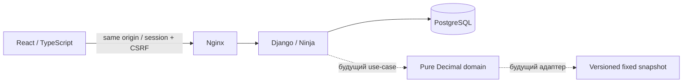

# Архитектура

Один репозиторий и модульный монолит: проще согласовать изменения API/типов/миграций. Фронт компилируется в статические файлы; Nginx проксирует API в той же origin. Секреты существуют только на сервере. Django sessions хранятся в PostgreSQL; HttpOnly cookie содержит идентификатор сессии, CSRF-cookie доступна клиенту для заголовка.

Сегодня реализован сквозной сценарий: login → создать личный черновик → reload → подтвердить → logout. Цели не рассчитываются автоматически; подтверждение не запускает транзакции или внешние вызовы. Записи пользователя от другого пользователя скрыты, а не просто исключены из интерфейса. Список ограничен страницей 50 записей. Для будущего активно редактируемого списка понадобится cursor pagination вместо offset.

`domain/capital.py` — изолированный пример будущего ядра FR-2, пока не подключён к HTTP/UI. Направление зависимостей: HTTP/use-case → domain; domain не знает об инфраструктуре. Снимки, ограничения, налоги и результат расчёта ещё предстоит спроектировать. Их версии и точные входы обязательно хранить вместе с результатом; не хранить только итоговую сумму.

Контракт: Pydantic Schema → `contracts/openapi.json` → generated TypeScript. `make contract-check` сравнивает файлы, ничего не переписывает. Публичная Swagger/schema-ручка отключена, версия контракта хранится в Git. Auth endpoints — штатные Django views, их отдельный контракт описан в `docs/api.md`.

Наблюдаемость: `/health/live` проверяет процесс, `/health/ready` проверяет доступность таблицы приложения. Логи не должны содержать bodies, пароли или финансовые параметры. Production telemetry, request IDs и error tracking добавляются отдельно после выбора провайдера. Ошибки готовности не раскрывают DSN/исключения.

Расширение: сначала domain и приёмочные fixtures, затем use-case, persistence, API и UI; AI — внешний адаптер после рабочего ручного сценария. Брокерской интеграции нет даже как фиктивной успешной ручки.
